```{r setup, include=FALSE}
knitr::opts_chunk$set(echo = TRUE)
library(tidypopgen)
library(kableExtra)
library(writexl)
```

```{r set-directories, echo=FALSE, results='hide', message=FALSE, warning=FALSE}
res_dir <- "../results/s10_supplementary/"
```

```{r, echo=FALSE, results='hide', message=FALSE, warning=FALSE}
madagascar <- gt_load("../data/raw/data_input/Madagascar_full.gt")
pop_table <- read.table("../data/raw/data_input/Madagascar_Borneo.poptable",
  sep = "\t", fill = TRUE
)
colnames(pop_table) <- c("IID", "V2", "FID", "Population", "V5", "V6", "V7")
pop_table$IID <- paste0(pop_table$IID, "RR")
pop_table_sub <-
  subset(
    pop_table,
    pop_table$IID %in% madagascar$id & pop_table$V5 == "Madagascar"
  )
matching_m <- match(madagascar$id, pop_table_sub$IID)
madagascar$population <-
  ifelse(!is.na(matching_m),
    pop_table_sub$Population[matching_m], madagascar$population
  )

madagascar_p <- gt_load("../data/raw/data_input/Pierron_Malagasy.gt")

g1000 <- gt_load("../data/raw/data_input/1000_Genomes_b37_clean.gt")
pop_table <- read.table("../data/raw/data_input/Madagascar_Borneo.poptable",
  sep = "\t", fill = TRUE
)
colnames(pop_table) <- c("IID", "V2", "FID", "Population", "V5", "V6", "V7")
pop_table_sub <- subset(pop_table, pop_table$IID %in% g1000$id)
matching_m <- match(g1000$id, pop_table_sub$IID)
g1000$population <- ifelse(!is.na(matching_m),
  pop_table_sub$V2[matching_m],
  g1000$population
)
pop <- c("KHV", "BEB", "YRI", "PJL", "GWD", "MSL", "ESN", "LWK", "CHS")
g1000 <- g1000 %>% filter(population %in% pop)

borneo <- gt_load("../data/raw/data_input/Borneo_raw_data.gt")
sumba <- gt_load("../data/raw/data_input/GSE76645_INDONESIA_SUMBA_TIMOR.gt")
timor <- read.table("../data/raw/data_input/timor")
bantu_african <- gt_load("../data/intermediate/rbind_data/NEO_full.gt")

malagasy_merged <-
  gt_load("../data/intermediate/rbind_data/malagasy_merge_clean")
malagasy_merged_ld <-
  gt_load("../data/intermediate/rbind_data/malagasy_merge_clean_ld.gt")

mad_bor_g1000_sum <-
  gt_load("../data/intermediate/rbind_data/mad_bor_g1000_sum_neo_clean.gt")
mad_bor_g1000_sum_ld <-
  gt_load("../data/intermediate/rbind_data/mad_bor_g1000_sum_neo_clean_ld.gt")

mad_bor_g1000_sum_clean_neo_ld_sub_path <-
  "../data/intermediate/rbind_data/mad_bor_g1000_sum_clean_neo_ld_subsampled.gt"
mad_bor_g1000_sum_subsample_pca <-
  gt_load(mad_bor_g1000_sum_clean_neo_ld_sub_path)

moz_pop <-
  unique(grep("^Mozambique", mad_bor_g1000_sum_ld$population, value = TRUE))
pops <- c(
  "Borneo", moz_pop, "Betsimisaraka", "Merina", "Diego",
  "Sakalava_Tsimihety", "Betsileo", "Vezo", "Mikea", "Temoro"
)
mad_bor_g1000_sum_subsample_supervised_admix <- mad_bor_g1000_sum_ld %>%
  filter(population %in% pops)

# admixture
K <- 2:10

# MALDER
mindis <- 0.005
binsize <- 0.0005
mad_bor_g1000_sum_neo_no_ld_path <-
  "../data/intermediate/rbind_data/rbind_sort_dist/mad_bor_g1000_sum_neo_no_ld.gt"
mad_bor_g1000_sum_neo_malder <-
  gt_load(mad_bor_g1000_sum_neo_no_ld_path)

# f4 ratio
f4 <- gt_load("../data/intermediate/pan_tro_liftover/chimp_ref_outgroup.gt")
```

# Supplementary 

## Data cleaning

Only autosomal SNPs were analysed.  SNPs with a missingness rate above 0.05 were removed.  Individuals with a genotype call rate less than 0.9 (missingness exceeding 0.1) were removed. SNPs with minor allele frequency below 0.025 were removed. Hardy-Weinberg equilibrium p-values were calculated for each SNP within each population using the tidypopgen function qc_report_loci, which provides a Bonferroni correction given the number of populations analysed. SNPs with a p-value below 0.01 in at least one population after correction were removed. Close relatives were removed using the KING robust kinship coefficient @manichaikulRobustRelationshipInference2010, implemented in tidypopgen. One individual was removed from each pair with a kinship coefficient greater than 0.0884, equivalent to removing relatives up to the second degree. After this filtering, the Malagasy dataset consisted of `r nrow(malagasy_merged)` individuals and `r count_loci(malagasy_merged)` SNPs, and the global dataset consisted of `r nrow(mad_bor_g1000_sum)` individuals and `r count_loci(mad_bor_g1000_sum)` SNPs.

SNPs in linkage were then removed by LD clumping @priveEfficientAnalysisLargescale2018, using tidypopgen. Those with an r2 value greater than 0.2 in a window of 100 kilobases were removed. After LD clumping, the Malagasy dataset consisted of `r count_loci(malagasy_merged_ld)` SNPs and the global dataset consisted of `r count_loci(mad_bor_g1000_sum_ld)` SNPs.

## PCA

Principal components analysis (PCA) was used to visualise the Malagasy dataset, and the Malagasy individuals compared to global comparative data. Non-malagasy populations were randomly subsampled to a maximum of 30 individuals to avoid uneven sampling bias. This left a total of `r nrow(mad_bor_g1000_sum_subsample_pca)` individuals.

## Clustering

Unsupervised clustering using ADMIXTURE @alexanderFastModelbasedEstimation2009 was run on the full, cleaned dataset of `r nrow(mad_bor_g1000_sum)` individuals and `r count_loci(mad_bor_g1000_sum)` SNPs using the package tidypopgen @carterTidypopgenTidyPopulation2025b. The algorithm was run for `r length(K)` values of K (`r min(K)` to `r max(K)`) with 5-fold cross validation.

## f~2~ and f~3~ statistics

f~2~ statistics were calculated in tidypopgen @carterTidypopgenTidyPopulation2025, f~3~ and f~4~ ratio statistics were then calculated in Admixtools2 from these f~2~ blocks @maierAdmixtoolsInferringDemographic2024. Admixture f~3~ statistics were used in the configuration f~3~(Malagasy; Asian, African) to test whether the Malagasy population could be modelled as an admixture between the given African and Asian references.

## Merina substructure

As the Merina exhibited high inter-individual variation in ADMIXTURE ancestry profiles, indicative of some form of population structure, we ran supervised ADMIXTURE @alexanderFastModelbasedEstimation2009 at K = 2 for all Malagasy populations. Borneo and Mozambique were used as reference populations in this supervised mode, as these reference populations gave the minimum f3 values. Each population showed inter-individual variation in ancestry proportions. However, the Merina exhibited a bimodal distribution @alexanderFastModelbasedEstimation2009, as reported previously @hodgsonGenomicInvestigationMalagasy2016. Merina with a high proportion of African ancestry and Merina with a high proportion of Asian ancestry were separated before running MALDER and pairwise FST analyses. Individuals were assigned to Merina A or Merina B based on their ancestry profile at k = 2 inferred using supervised ADMIXTURE @alexanderFastModelbasedEstimation2009, with Merina A estimated to have \>50% of ancestry derived from a population similar to Borneo individuals, and Merina B estimated to have \>50% of ancestry derived from a population similar to Mozambique individuals. See supplementary Figure 2 for results of supervised ADMIXTURE analysis. Splitting this sample reduced power, as only 12 individuals remained in the higher African ancestry group. However, this avoided violating model assumptions (e.g the model of linkage employed by ALDER assumes no population substructure and panmixia) and enabled us to consider whether there may be differing demographic histories among the Merina.

## f~4~ ratio

f~4~ ratio statistics were used to examine the proportion of ancestry derived from Asian versus African sources for each population. To obtain these ratios, the global dataset was merged with 1000 Genomes GBR and a chimpanzee reference (PanTro3.0, GenBank accession GCA_000001515.5) to act as outgroups. f~4~ ratios were calculated in the configurations f~4~(GBR,Chimpanzee;Malagasy,Borneo) / f~4~(GBR,Chimpanzee;Esan,Borneo) and f~4~(GBR,Chimpanzee;Malagasy,Esan) / f~4~(GBR,Chimpanzee;Borneo,Esan).

To obtain a chimpanzee reference, SNPs in our dataset were lifted to PanTro3.0 (GenBank accession GCA_000001515.5) from hg19 using liftOver overchain file <https://hgdownload.soe.ucsc.edu/goldenPath/hg19/liftOver/hg19ToPanTro5.over.chain.gz> from UCSC Genome Browser @kentHumanGenomeBrowser2002, using bigsnpr function snp_modifyBuild() @priveEfficientAnalysisLargescale2018. The chimpanzee reference for each SNP was obtained using a custom R function to query the Ensembl API (GenBank accession GCA_000001515.5, Ensembl release 115, accessed via Ensembl API <https://rest.ensembl.org/documentation/info/sequence_region> on 17-12-2025). This procedure retained 77993 SNPs for f~4~ ratio calculation. Standard errors were calculated using block-jackknife resampling (admixtools f~4~ ratio default). Supplementary Table 5 contains full f~4~ ratio output.

## MALDER

MALDER @lohInferringAdmixtureHistories2013; @pickrellAncientWestEurasian2014 was used to date the timing of admixture. Genetic distances were set using HapMap Phase II genetic map @frazerSecondGenerationHuman2007, mapped to build GRCh37. tidypopgen was used to create a subset of the full dataset containing only SNPs with known genetic map positions in the correct order. This dataset was not pruned for linkage disequilibrium, and consisted of `r count_loci(mad_bor_g1000_sum_neo_malder)` SNPs. MALDER was run using the default -binsize of 5 \* 10-4 Morgans (describing the size of the bins that SNPs are split up into. Instead of directly calculating distance between each SNP pair, MALDER uses the distance between the bins of each SNP pair.), and the –mindis parameter (minimum genetic distance to begin LD decay curve fitting) set to 0.005 cM. Standard error of estimated dates were calculated through leave-one-chromosome-out jackknifing, with the flag -jackknife.

## Pairwise F~st~ 

Pairwise F~st~ distances between Malagasy populations were calculated in tidypopgen, using the method of @weirEstimatingFStatisticsAnalysis1984.

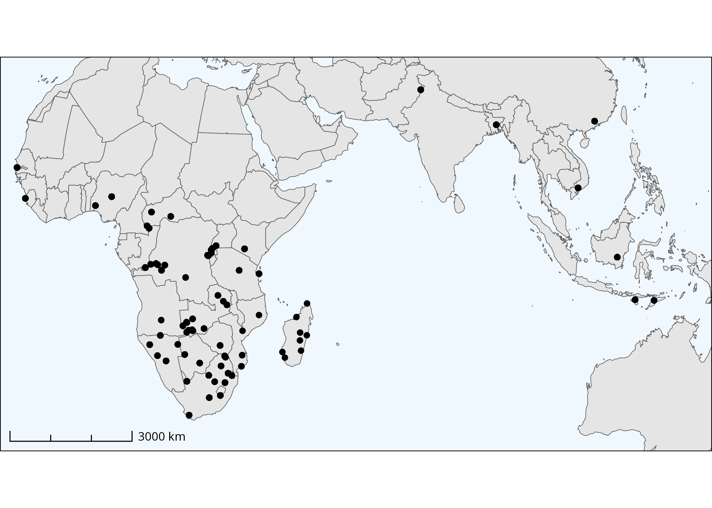


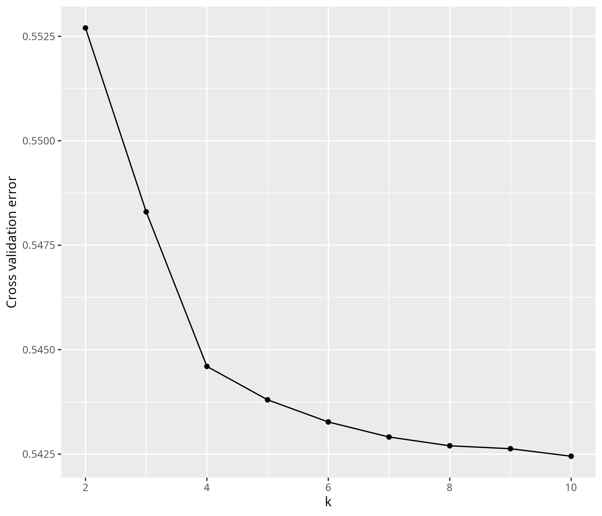

![Supplementary Figure 4: Supervised admixture at K = 2 for Malagasy compared to reference populations. Individuals from Borneo from Brucato et al. (2016), and individuals from Mozambique populations from Fortes-Lima et al., (2024). Mozambique individuals are labelled together, but this group contains individuals given the following population labels: "Mozambique_Nhungwe", "Mozambique_Tsonga", "Mozambique_Ronga", "Mozambique_TongaMoz", "Mozambique_Chuwabu", "Mozambique_Tswa", "Mozambique_Chopi", "Mozambique_Sena", "Mozambique_Makhuwa”.](../results/s05_b_supervised/Admixture_supervised_malagasy.jpg)

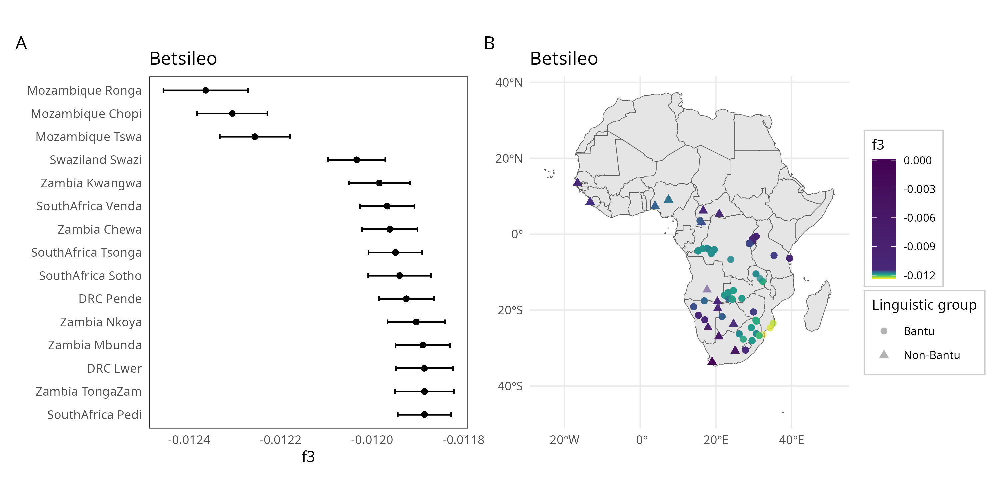

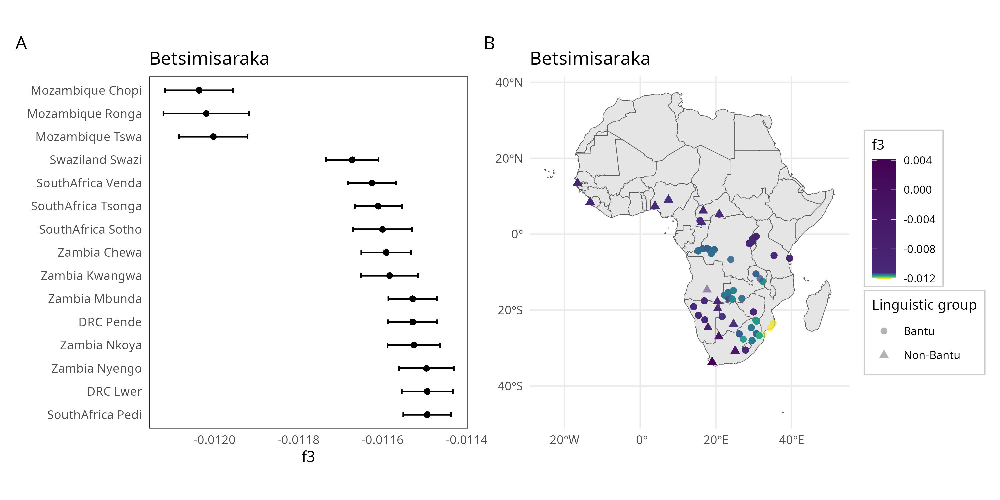

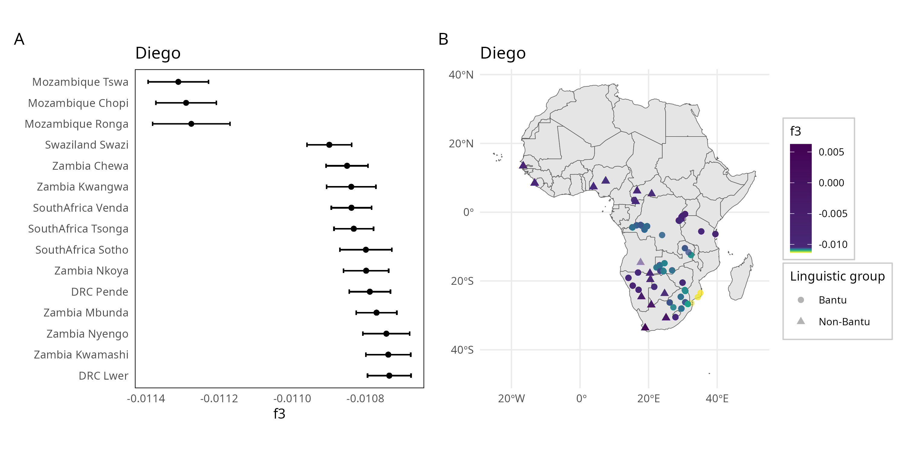

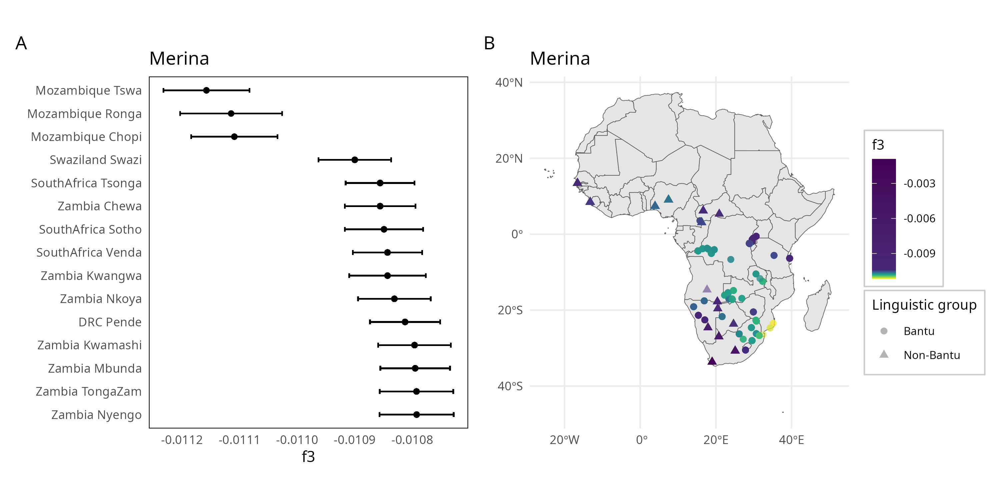

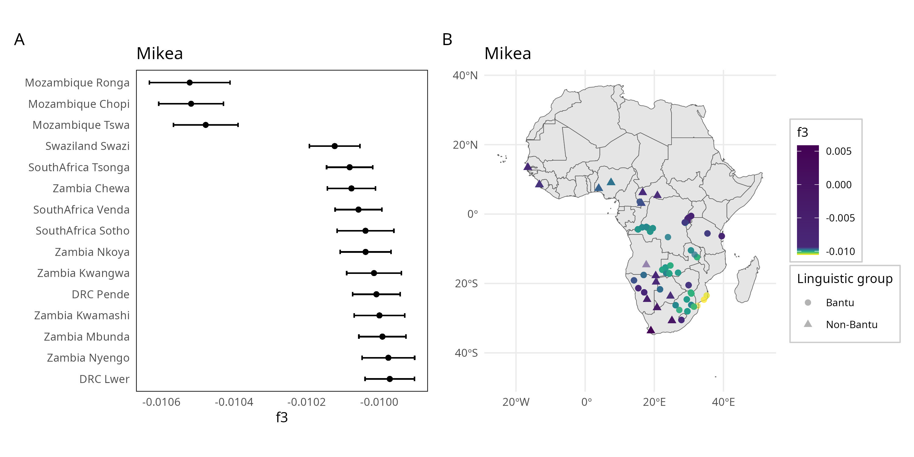

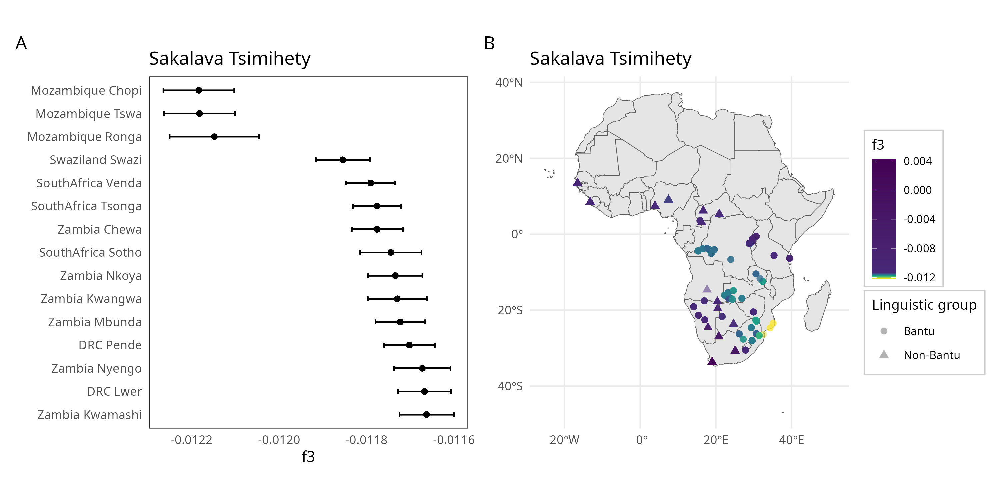

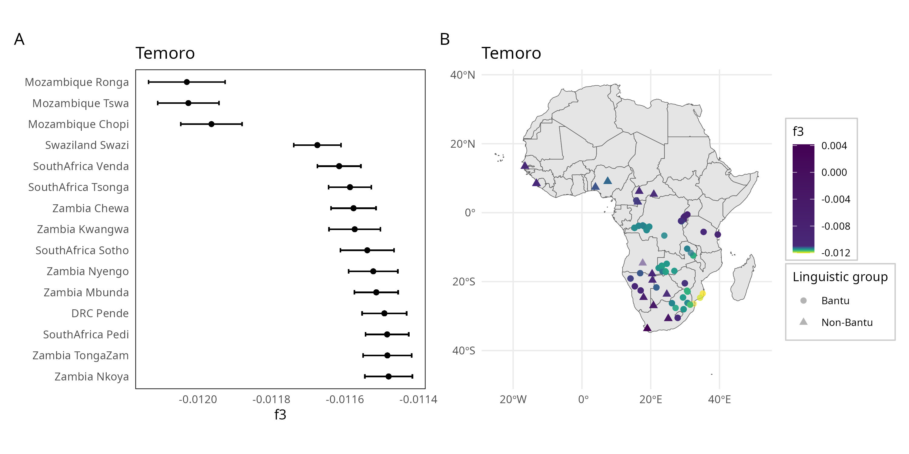

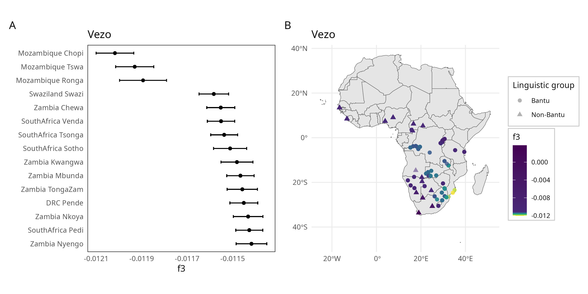


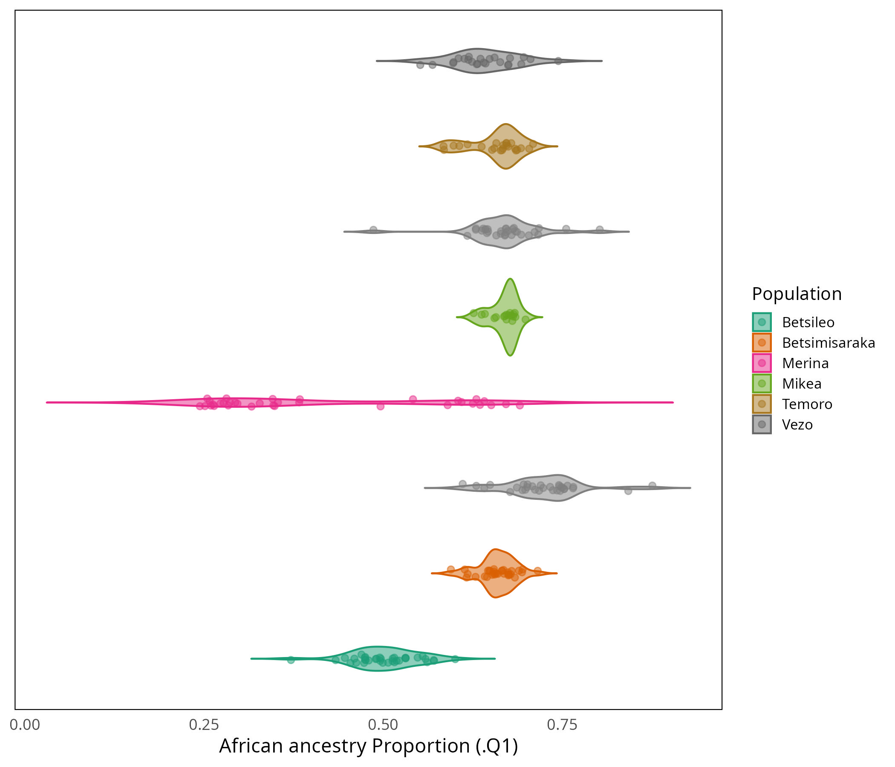

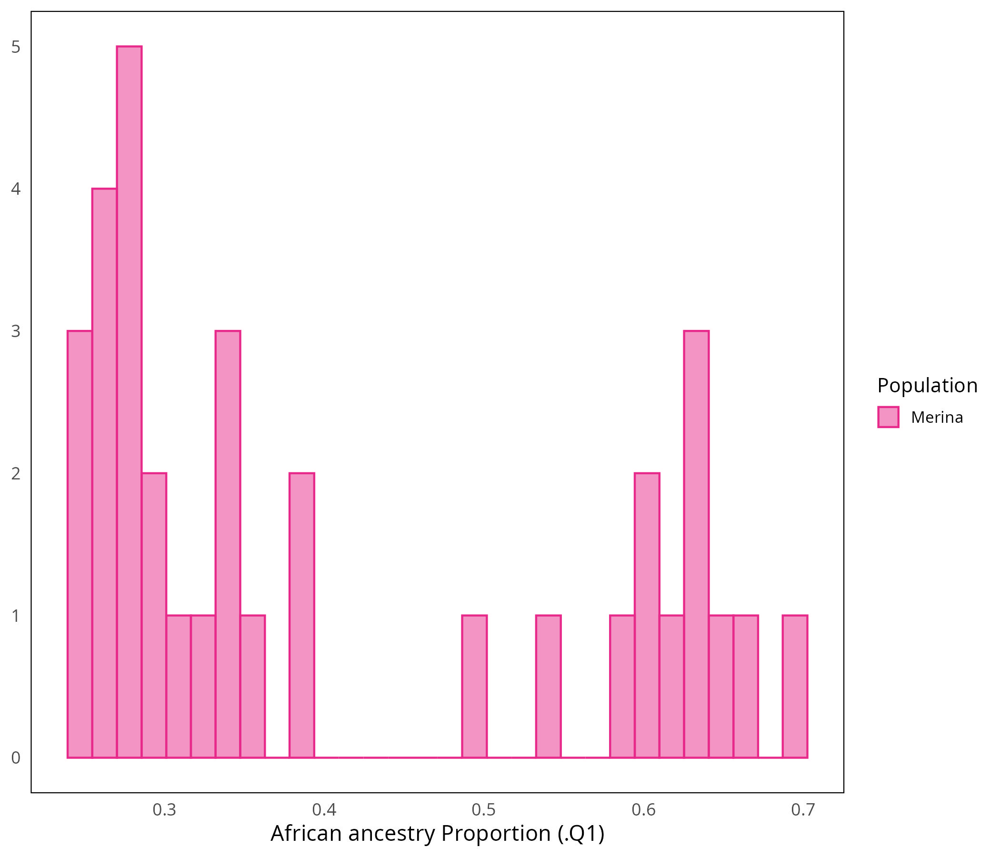


\clearpage

```{r, echo=FALSE, results='hide', message=FALSE, warning=FALSE}
df <- data.frame(
  table(mad_bor_g1000_sum$population)
)

colnames(df) <- c("Population", "Sample size")
# rename
df$Population <- sub("BOR", "Borneo", df$Population)
df$Population <- sub("CHS", "Han, China", df$Population)
df$Population <- sub("KHV", "Kinh, Vietnam", df$Population)
df$Population <- sub("PJL", "Punjabi, Pakistan", df$Population)
df$Population <- sub("BEB", "Bengali, Bengal", df$Population)

df$Population <- sub("ESN", "Esan, Nigeria", df$Population)
df$Population <- sub("YRI", "Yoruba, Nigeria", df$Population)
df$Population <- sub("GWD", "Mandinka, The Gambia", df$Population)
df$Population <- sub("LWK", "Luhye, Kenya", df$Population)
df$Population <- sub("MSL", "Mende, Sierra Leone", df$Population)

df$source <- NA
df$source <-
  ifelse(df$Population == "Borneo", "Brucato et al., 2016", df$source)
df$source <-
  ifelse(df$Population %in% c("Sumba", "Timor"), "Cox et al., 2016", df$source)
df$source <-
  ifelse(df$Population %in% c("Vezo", "Mikea", "Temoro"),
    "Pierron et al., 2014",
    df$source
  )
df$source <- ifelse(df$Population %in% c("Merina", "Betsileo", "Sakalava_Tsimihety", "Betsimisaraka", "Diego"), "This study", df$source)
df$source <- ifelse(df$Population %in% c("Esan, Nigeria", "Yoruba, Nigeria", "Mandinka, The Gambia", "Luhye, Kenya", "Mende, Sierra Leone", "Han, China", "Kinh, Vietnam", "Punjabi, Pakistan", "Bengali, Bengal"), "1000 Genomes Project Consortium, 2015", df$source)
df$source <- ifelse(is.na(df$source), "Fortes-Lima et al., 2024", df$source)

df <- rbind(df, c("Total", sum(df$`Sample size`)))

write.csv(df,
  paste0(res_dir, "sample_sizes_global_dataset.txt"),
  sep = ",",
  qmethod = "double",
  row.names = FALSE
)
```

```{r, echo=FALSE, message=FALSE, warning=FALSE}
kable(df, caption = "Sample sizes for each population in the global dataset after filtering.") %>%
  kable_styling(
    latex_options = c("repeat_header", "longtable")
  )
```

````{=tex}
\newgeometry{left=1cm,right=1cm,top=1cm,bottom=1cm}
\begin{landscape}

```{r, echo=FALSE, message=FALSE, warning=FALSE}
full_loci_fiter <- "Non-autosomal; Missingness < 0.05; HWE p > 0.01; MAF > 0.025; LD clumping"

df <- data.frame(
  analysis <- c("Malagasy PCA", "Global PCA", "Unsupervised clustering", "Supervised clustering", "F3 statistics", "F4 ratio statistics", "MALDER", "Pairwise FST"),
  package_function <- c(
    "tidypopgen: gt\\_pca\\_randomSVD",
    "tidypopgen: gt\\_pca\\_randomSVD",
    "tidypopgen: gt\\_admixture",
    "ADMIXTURE: ADMIXTURE",
    "tidypopgen: gt\\_extract\\_f2; admixtools2 (version 2.0.8) (Maier and Patterson, 2024): qp3pop",
    "tidypopgen: gt\\_extract\\_f2; admixtools2 (version 2.0.8) (Maier and Patterson, 2024): qpf4ratio",
    "MALDER (version 1.0) (Pickrell et al., 2014): MALDER",
    "tidypopgen: pairwise\\_pop\\_fst - method = \"WC84\" (Weir and Cockerham, 1984)"
  ),
  data <- c("Malagasy dataset", "Global dataset", "Global dataset", "Subset of Global dataset", "Global dataset", "Global dataset + Pan and European outgroups", "Global dataset", "Global dataset"),
  indiv_filter <- rep("Missingness > 0.1; KING kinship > 0.0884", 8),
  loci_filter <- c(
    rep(full_loci_fiter, 6),
    "Non-autosomal; Missingness < 0.05; HWE p > 0.01; MAF > 0.025",
    full_loci_fiter
  ),
  total_indiv <- c(
    nrow(malagasy_merged_ld),
    nrow(mad_bor_g1000_sum_ld),
    nrow(mad_bor_g1000_sum_ld),
    nrow(mad_bor_g1000_sum_subsample_supervised_admix),
    nrow(mad_bor_g1000_sum_ld),
    nrow(f4),
    nrow(mad_bor_g1000_sum_neo_malder),
    nrow(mad_bor_g1000_sum_ld)
  ),
  total_loci <- c(
    count_loci(malagasy_merged_ld),
    count_loci(mad_bor_g1000_sum_ld),
    count_loci(mad_bor_g1000_sum_ld),
    count_loci(mad_bor_g1000_sum_subsample_supervised_admix),
    count_loci(mad_bor_g1000_sum_ld),
    count_loci(f4),
    count_loci(mad_bor_g1000_sum_neo_malder),
    count_loci(mad_bor_g1000_sum_ld)
  )
)
colnames(df) <- c(
  "Analysis", "Package/function", "Dataset",
  "Individuals Removed", "n indivs",
  "Loci filtering", "n SNPs"
)

kable(df,
  format = "latex",
  booktabs = TRUE,
  escape = FALSE,
  caption = "Summary of analyses and software used in this study."
) %>%
  column_spec(2, width = "5cm") %>%
  column_spec(4, width = "4cm") %>%
  column_spec(5, width = "4cm") %>%
  kable_styling(
    latex_options = c("hold_position", "scale_down"),
    font_size = 8
  )
```

\end{landscape}
\restoregeometry
````

```{r, echo=FALSE, message=FALSE, warning=FALSE}
min_f3 <- read.table("../results/s06_b_f_stats/minimum_f3_malagasy_pops",
  header = TRUE, sep = "\t"
)

kable(min_f3, caption = "Minimum f3 statistic values across all combinations of references for each Malagasy population.
")
```

```{r, echo=FALSE, message=FALSE, warning=FALSE}
min_f3 <- read.table("../results/s06_b_f_stats/minimum_z-score_malagasy_pops",
  header = TRUE, sep = "\t"
)

kable(min_f3, caption = "Minimum z-scores for f3 statistics across all combinations for each Malagasy population.")
```

```{r, echo=FALSE, message=FALSE, warning=FALSE}
f4_ratios <- read.table("../results/s06_b_f_stats/f4_ratio_african_admixture",
  header = TRUE, sep = "\t"
)

kable(f4_ratios, caption = "f4 ratios calculated with admixtools. f4 ratios were calculated in the configurations  f4(GBR,Chimpanzee;Malagasy,Borneo) / f4(GBR,Chimpanzee;Esan,Borneo) and f4(GBR,Chimpanzee;Malagasy,Esan) / f4(GBR,Chimpanzee;Borneo,Esan)
")
```

```{r, echo=FALSE, results='hide', message=FALSE, warning=FALSE}
malder <- readRDS("../results/s07_MALDER/malder_results_all.RDS")

malder <- malder %>%
  select(-c(test_res, admixture_date, CI, amp_exp, amp_exp_CI))

asian <- c("Borneo", "Sumba", "Dai")
african <- c("Esan", "Yoruba", "Mozambique_Chopi")
malder <- malder %>%
  filter(!(`ref A` %in% asian & `ref B` %in% asian)) %>%
  filter(!(`ref A` %in% african & `ref B` %in% african))
```

````{=tex}
\newgeometry{left=1cm,right=1cm,top=1cm,bottom=1cm}
\begin{landscape}

```{r, echo=FALSE, message=FALSE, warning=FALSE}
kable(malder, longtable = TRUE, caption = "MALDER results for all Malagasy populations, with varied African and Asian source populations. p value: significance of model tested. test pop: Malagasy target population. ref A: Asian population. ref B: African population. 2 ref z score: z score. 2 ref decay: Date, in generations before present, since admixture began with standard error. 2 ref amp exp: Amplitude of the LD decay curve. amp aff: Affine term estimating population substructure.") %>%
  kable_styling(
    latex_options = c("repeat_header", "scale_down")
  )
```


```{r, echo=FALSE, message=FALSE, warning=FALSE}
fst_matrix <- read.table("../results/s08_FST/fst_matrix_full.txt",
  header = TRUE, row.names = 1, sep = ","
)
fst_matrix <- as.data.frame(fst_matrix)
kable(fst_matrix,
  format = "latex",
  booktabs = TRUE,
  escape = FALSE,
  row.names = TRUE,
  caption = "Pairwise FST values between all Malagasy populations."
)
```

\end{landscape}
\restoregeometry
````


***

```{r save-r-environment, echo=FALSE, results='hide', message=FALSE, warning=FALSE}
filename_rmd <- "s10_supplementary.Rmd"
filename_renv <- paste0(
  res_dir, "/renv_",
  tools::file_path_sans_ext(basename(filename_rmd)),
  ".json"
)
renv::lockfile_write(renv::lockfile_create(), file = filename_renv)
```
