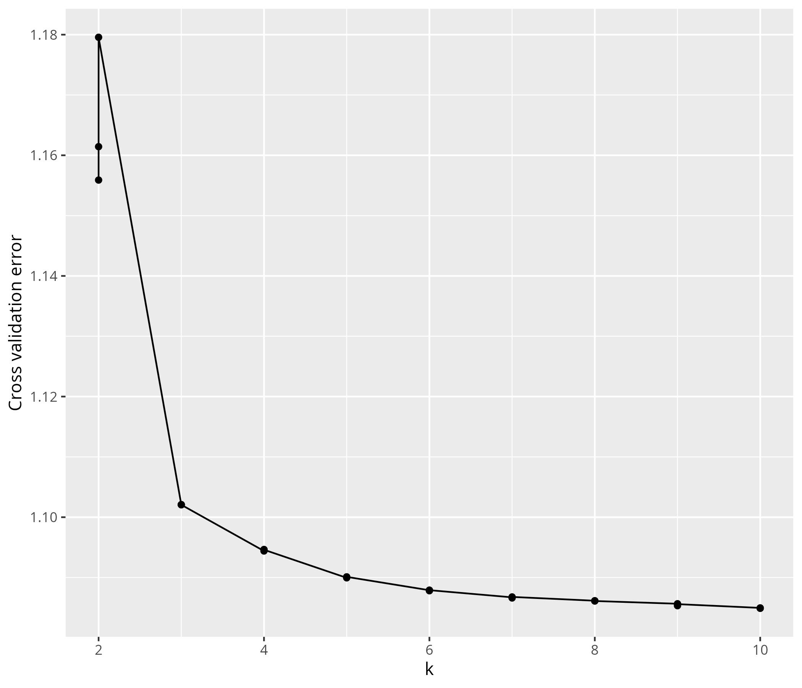

```{r setup, include=FALSE}
knitr::opts_chunk$set(echo = TRUE)
library(tidypopgen)
library(kableExtra)
```

```{r, echo=FALSE, results='hide', message=FALSE, warning=FALSE}
madagascar <- gt_load("../data/raw/data_input/Madagascar_full.gt")
pop_table <- read.table("../data/raw/data_input/Madagascar_Borneo.poptable",
  sep = "\t", fill = TRUE
)
colnames(pop_table) <- c("IID", "V2", "FID", "Population", "V5", "V6", "V7")
pop_table$IID <- paste0(pop_table$IID, "RR")
pop_table_sub <-
  subset(
    pop_table,
    pop_table$IID %in% madagascar$id & pop_table$V5 == "Madagascar"
  )
matching_m <- match(madagascar$id, pop_table_sub$IID)
madagascar$population <-
  ifelse(!is.na(matching_m),
    pop_table_sub$Population[matching_m], madagascar$population
  )

madagascar_p <- gt_load("../data/raw/data_input/Pierron_Malagasy.gt")

g1000 <- gt_load("../data/raw/data_input/1000_Genomes_b37_clean.gt")
pop_table <- read.table("../data/raw/data_input/Madagascar_Borneo.poptable",
  sep = "\t", fill = TRUE
)
colnames(pop_table) <- c("IID", "V2", "FID", "Population", "V5", "V6", "V7")
pop_table_sub <- subset(pop_table, pop_table$IID %in% g1000$id)
matching_m <- match(g1000$id, pop_table_sub$IID)
g1000$population <- ifelse(!is.na(matching_m),
  pop_table_sub$V2[matching_m],
  g1000$population
)
pop <- c("KHV", "BEB", "YRI", "PJL", "GWD", "MSL", "ESN", "LWK", "CHS")
g1000 <- g1000 %>% filter(population %in% pop)

borneo <- gt_load("../data/raw/data_input/Borneo_raw_data.gt")
sumba <- gt_load("../data/raw/data_input/GSE76645_INDONESIA_SUMBA_TIMOR.gt")
timor <- read.table("../data/raw/data_input/timor")
bantu_african <- gt_load("../data/intermediate/rbind_data/NEO_full.gt")

malagasy_merged <- gt_load("../data/intermediate/rbind_data/malagasy_merge_clean")
malagasy_merged_ld <- gt_load("../data/intermediate/rbind_data/malagasy_merge_clean_ld.gt")

mad_bor_g1000_sum <- gt_load("../data/intermediate/rbind_data/mad_bor_g1000_sum_neo_clean.gt")
mad_bor_g1000_sum_ld <- gt_load("../data/intermediate/rbind_data/mad_bor_g1000_sum_neo_clean_ld.gt")

mad_bor_g1000_sum_subsample_pca <- gt_load("../data/intermediate/rbind_data/mad_bor_g1000_sum_clean_neo_ld_subsampled.gt")

moz_pop <- unique(grep("^Mozambique", mad_bor_g1000_sum_ld$population, value = TRUE))
pops <- c(
  "Borneo", moz_pop, "Betsimisaraka", "Merina", "Diego",
  "Sakalava_Tsimihety", "Betsileo", "Vezo", "Mikea", "Temoro"
)
mad_bor_g1000_sum_subsample_supervised_admix <- mad_bor_g1000_sum_ld %>% filter(population %in% pops)
  
# Fastmixture
K <- 2:10
runs <- 3

# MALDER
mindis <- 0.005
binsize <- 0.0005
mad_bor_g1000_sum_neo_malder <-
  gt_load("../data/intermediate/rbind_data/rbind_sort_dist/mad_bor_g1000_sum_neo_no_ld.gt")
```

# Methods

Human genetic sampling was conducted under informed consent procedure approved by the Pennsylvania State University and the Madagascar Ministry of Health. Participants were recruited from five localities in Madagascar, and each participant was asked their ethnic group and that of their grandparents. Saliva containing DNA was collected from each participant using Oragene collection tubes. DNA was extracted from saliva samples, and DNA concentrations were standardised in preparation for genotyping using Nanodrop.

Genetic and phenotypic data were collected by the team of Dr George Perry at Pennsylvania State University with the University of Antananarivo. Dr Jason Hodgson and Dr Rindra Rakotoarivony led this data collection in 2015. These data comprise of `r nrow(madagascar)` individuals from five regions: Merina people from the Central Highlands (n = `r madagascar %>% filter(population == "Merina") %>% nrow()`), Betsileo people from the southern Highlands (n = `r madagascar %>% filter(population == "Betsileo") %>% nrow()`), Sakalava and Tsimihety people from the northwestern coast (n = `r madagascar %>% filter(population == "Sakalava_Tsimihety") %>% nrow()`), Betsimisaraka people from the eastern coast (n = `r madagascar %>% filter(population == "Betsimisaraka") %>% nrow()`), and people of various ethnic groups from the extreme north in the town of Diego (n = `r madagascar %>% filter(population == "Diego") %>% nrow()`). \~690,000 SNPs were typed using the Illumina HumanOmniExpress-24 array.

Two main datasets were created, a Malagasy only dataset and a global comparative dataset. The Malagasy dataset was created by merging our data with Malagasy data from @pierronGenomewideEvidenceAustronesian2014 (Mikea; n = 21, Temoro; n = 24, Vezo; n = 24). For a comparative global dataset, this data was combined with data from southeast Asian and African populations in the @autonGlobalReferenceHuman2015 dataset (n = `r nrow(g1000)`), Bantu African individuals from @fortes-limaGeneticLegacyExpansion2024 (n = `r nrow(bantu_african)`), individuals from Borneo from @brucatoMalagasyGeneticAncestry2016 (n = `r nrow(borneo)`), and individuals from the islands of Sumba (n = 30, subsampled at random from the full dataset of `r nrow(sumba)` individuals) and Timor (n = `r nrow(timor)`) @coxSmallTraditionalHuman2016. The genome build of each dataset was verified using the function `snp_modifyBuild` from `bigsnpr` @priveEfficientAnalysisLargescale2018 prior to merging to ensure each dataset used the same build (in this case, GRC37).

Data were merged in R using tidypopgen function `rbind` @carterTidypopgenTidyPopulation2025, which merges SNP datasets, resolves strand inconsistencies, and removes ambiguous SNPs. After merging, datasets were cleaned using tidypopgen @carterTidypopgenTidyPopulation2025. Only autosomal SNPs were analysed. All SNPs with a missingness rate above 0.05 across all samples were removed. All individuals with a genotype call rate less than 0.9 (missingness exceeding 0.1) were removed. SNPs with minor allele frequency below a threshold of 0.025 were removed. Hardy-Weinberg equilibrium p-values were calculated for each SNP within each population using the tidypopgen function qc_report_loci, which provides a Bonferroni correction given the number of populations analysed. SNPs with a p-value below 0.01 in at least one population after correction were removed. Close relatives were removed using the KING robust kinship coefficient @manichaikulRobustRelationshipInference2010, implemented in tidypopgen. One individual was removed from each pair with a kinship coefficient greater than 0.0884, equivalent to removing relatives up to the second degree. After this filtering, the Malagasy dataset consisted of `r nrow(malagasy_merged)` individuals and `r count_loci(malagasy_merged)` SNPs, and the global dataset consisted of `r nrow(mad_bor_g1000_sum)` individuals and `r count_loci(mad_bor_g1000_sum)` SNPs.

SNPs in linkage were then removed by LD clumping @priveEfficientAnalysisLargescale2018, using tidypopgen. Those with an r2 value greater than 0.2 in a window of 100 kilobases were removed. After LD clumping, the Malagasy dataset consisted of `r count_loci(malagasy_merged_ld)` SNPs and the global dataset consisted of `r count_loci(mad_bor_g1000_sum_ld)` SNPs.

Principal components analysis (PCA) was used firstly to visualise the Malagasy dataset, and secondly the Malagasy individuals compared to global comparative data. Non-malagasy populations were randomly subsampled to a maximum of 30 individuals to avoid bias through uneven sample sizes. This left a total of `r nrow(mad_bor_g1000_sum_subsample_pca)` individuals.

Unsupervised clustering using the model-based method fastmixture @santanderFasterModelbasedEstimation2024 was run on the full, cleaned dataset of `r nrow(mad_bor_g1000_sum)` individuals and `r count_loci(mad_bor_g1000_sum)` SNPs using the package tidygenclust @tysallTidygenclustClusteringPopulation2025. Fastmixture has been shown to be computationally efficient for large datasets while providing comparable results to other model-based clustering algorithms such as STRUCTURE @pritchardInferencePopulationStructure2000 and ADMIXTURE @alexanderFastModelbasedEstimation2009, with reported speeds up to 30 times faster than ADMIXTURE @fumagalliFastmixtureGeneratesFast2024.

The algorithm was run for `r length(K)` values of K (`r min(K)` to `r max(K)`) and `r runs` runs per K with 5-fold cross validation. Subsequently, we analysed the fastmixture output using the Clumppling algorithm of @liuClumpplingClusterMatching2024, also implemented in tidygenclust @tysallTidygenclustClusteringPopulation2025. Clumppling aligns replicated runs of unsupervised clustering across multiple values of K to identify modes across replicates. A single mode was found for each value of K across `r runs` replicates.

f~2~ statistics were calculated in tidypopgen @carterTidypopgenTidyPopulation2025, f~3~ and f~4~ ratio statistics were then calculated in Admixtools2 from these f~2~ blocks @maierAdmixtoolsInferringDemographic2024. Admixture f~3~ statistics were used in the configuration f~3~(Malagasy; Asian, African) to test whether the Malagasy population could be modelled as an admixture between the given African and Asian references.

As the Merina exhibited high inter-individual variation in fastmixture ancestry profiles, indicative of some form of population structure, we ran the supervised mode of ADMIXTURE @alexanderFastModelbasedEstimation2009 at K = 2 for all Malagasy populations. Individuals from Borneo and individuals from Mozambique were used as reference populations in this supervised mode, as these reference populations were shown to give the minimum admixture f3 statistics values. Every Malagasy population showed inter-individual variation in ancestry proportions. However, supervised ADMIXTURE profiles revealed a bimodal distribution among the Merina @alexanderFastModelbasedEstimation2009, which has been observed previously in this population @hodgsonGenomicInvestigationMalagasy2016. Merina with a high proportion of African ancestry and the Merina with a high proportion of Asian ancestry were then separated into two groups before running MALDER and pairwise FST analyses. Each individual was assigned to group Merina A or group Merina B based on their ancestry profile at k = 2 inferred using supervised ADMIXTURE @alexanderFastModelbasedEstimation2009, with Merina A estimated to have \>50% of ancestry derived from a population similar to Borneo individuals, and Merina B estimated to have \>50% of ancestry derived from a population similar to Mozambique individuals. See supplementary Figure 2 for results of supervised ADMIXTURE analysis. Splitting this sample reduced power, as only 12 individuals remained in the higher African ancestry group. However, doing so avoided violating model assumptions (e.g the model of linkage employed by ALDER assumes that there is no structure within populations, that individuals are mating at random) and enabled us to consider whether there may be differing demographic histories among the Merina.

f~4~ ratio statistics were used to examine the proportion of ancestry derived from Asian versus African sources for each population. To obtain these ratios, the global dataset was merged with 1000 Genomes GBR and a chimpanzee reference (PanTro3.0, GenBank accession GCA_000001515.5) to act as outgroups. f~4~ ratios were calculated in the configurations f~4~(GBR,Chimpanzee;Malagasy,Borneo) / f~4~(GBR,Chimpanzee;Esan,Borneo) and f~4~(GBR,Chimpanzee;Malagasy,Esan) / f~4~(GBR,Chimpanzee;Borneo,Esan).

To obtain a chimpanzee reference, first SNPs in our dataset were lifted to PanTro3.0 (GenBank accession GCA_000001515.5) from hg19 using liftOver overchain file <https://hgdownload.soe.ucsc.edu/goldenPath/hg19/liftOver/hg19ToPanTro5.over.chain.gz> from UCSC Genome Browser @kentHumanGenomeBrowser2002, through bigsnpr function snp_modifyBuild() @priveEfficientAnalysisLargescale2018. The chimpanzee reference for each SNP was then obtained using a custom R function to query the Ensembl API (GenBank accession GCA_000001515.5, Ensembl release 115, accessed via Ensembl API <https://rest.ensembl.org/documentation/info/sequence_region> on 17-12-2025). This procedure retained 77993 SNPs for f~4~ ratio calculation. Standard errors were calculated using block-jackknife resampling (admixtools f~4~ ratio default). See Supplementary Table 3 for full f~4~ ratio output.

MALDER @lohInferringAdmixtureHistories2013; @pickrellAncientWestEurasian2014 was used to date the timing of admixture across different Malagasy groups. Genetic distances for each SNP were set using HapMap Phase II genetic map @frazerSecondGenerationHuman2007, mapped to build GRCh37. tidypopgen was used to create a subset of the full dataset containing only SNPs with known genetic map positions in the correct order. This dataset was not pruned for linkage disequilibrium, and consisted of 236715 SNPs. MALDER was run using the default -binsize of 5 \* 10-4 Morgans (describing the size of the bins that SNPs are split up into. Instead of directly calculating distance between each SNP pair, MALDER uses the distance between the bins of each SNP pair.), and the –mindis parameter (minimum genetic distance to begin LD decay curve fitting) set to 0.005 cM. Standard error of estimated dates were calculated through leave-one-chromosome-out jackknifing, with the flag -jackknife.

Pairwise F~st~ distances between Malagasy populations were calculated in tidypopgen, using the method of @weirEstimatingFStatisticsAnalysis1984.

# Supplementary Data



![Supplementary Figure 2: Supervised admixture at K = 2 for for Malagasy compared to reference populations. Individuals from Borneo from Brucato et al. (2016), and individuals from Mozambique populations from Fortes-Lima et al., (2024). Mozambique individuals are labelled together, but this group contains individuals given the following population labels: "Mozambique_Nhungwe", "Mozambique_Tsonga", "Mozambique_Ronga", "Mozambique_TongaMoz", "Mozambique_Chuwabu", "Mozambique_Tswa", "Mozambique_Chopi", "Mozambique_Sena", "Mozambique_Makhuwa”.](../results/s05_b_supervised/Admixture_supervised_malagasy.jpg)


```{r, echo=FALSE, message=FALSE, warning=FALSE}
analysis <- c("Malagasy PCA", "Global PCA", "Unsupervised clustering", "Supervised clustering", "F3 statistics", "F4 ratio statistics", "MALDER", "Pairwise FST")
package_function <- c("tidypopgen: gt_pca_randomSVD", "tidypopgen: gt_pca_randomSVD", "tidygenclust: gt_fastmixture", "ADMIXTURE: ADMIXTURE", "tidypopgen: gt_extract_f2; admixtools2 (version 2.0.8) (Maier and Patterson, 2024): qp3pop", "tidypopgen: gt_extract_f2; admixtools2 (version 2.0.8) (Maier and Patterson, 2024): qpf4ratio", "MALDER (version 1.0) (Pickrell et al., 2014): MALDER", "tidypopgen: pairwise_pop_fst - method = “WC84”  (Weir and Cockerham, 1984)")
data <- c("Malagasy dataset", "Global dataset", "Global dataset", "Subset of Global dataset", "Global dataset", "Global dataset + Pan and European outgroups", "Global dataset", "Global dataset")
indiv_filter <- rep("Missingness > 0.1; KING kinship > 0.0884", 8)
full_loci_fiter <- "Non-autosomal; Missingness < 0.05; HWE p > 0.01; MAF > 0.025; LD clumping"
loci_filter <- c(rep(full_loci_fiter, 6),
                 "Non-autosomal; Missingness < 0.05; HWE p > 0.01; MAF > 0.025",
                 full_loci_fiter)
total_indiv <- c(nrow(malagasy_merged_ld),
                 nrow(mad_bor_g1000_sum_ld),
                 nrow(mad_bor_g1000_sum_ld),
                 nrow(mad_bor_g1000_sum_subsample_supervised_admix),
                 nrow(mad_bor_g1000_sum_ld),
                 nrow(mad_bor_g1000_sum_ld) + 48, #TODO check
                 nrow(mad_bor_g1000_sum),
                 nrow(mad_bor_g1000_sum_ld))
total_loci <- c(count_loci(malagasy_merged_ld),
                count_loci(mad_bor_g1000_sum_ld),
                count_loci(mad_bor_g1000_sum_ld),
                count_loci(mad_bor_g1000_sum_subsample_supervised_admix),
                count_loci(mad_bor_g1000_sum_ld),
                77993, #TODO check
                425904, #TODO check
                count_loci(mad_bor_g1000_sum_ld))


cbind(analysis, package_function, data, indiv_filter, total_indiv, loci_filter, total_loci) %>%
  as.data.frame() %>%
  kable(col.names = c("Analysis", "Package/function", "Dataset", "Individuals Removed", "n indivs", "Loci filtering", "n SNPs"), caption = "Supplementary Table 1: Summary of analyses and software used in this study.")

```

```{r, echo=FALSE, message=FALSE, warning=FALSE}
min_f3 <- read.table("../results/s06_b_f_stats/minimum_z-score_malagasy_pops",
                     header = TRUE, sep = "\t")

kable(min_f3, caption = "Supplementary Table 2: Minimum z-scores for f3 statistics across all combinations for each Malagasy population.")
```


```{r, echo=FALSE, message=FALSE, warning=FALSE}
f4_ratios <- read.table("../results/s06_b_f_stats/f4_ratio_african_admixture",
                     header = TRUE, sep = "\t")

kable(f4_ratios, caption = "Supplementary Table 3: f4 ratios calculated with admixtools. f4 ratios were calculated in the configurations  f4(GBR,Chimpanzee;Malagasy,Borneo) / f4(GBR,Chimpanzee;Esan,Borneo) and f4(GBR,Chimpanzee;Malagasy,Esan) / f4(GBR,Chimpanzee;Borneo,Esan)
")
```

```{r, echo=FALSE, results='hide', message=FALSE, warning=FALSE}
malder <- readRDS("../results/s07_MALDER/malder_results_all.RData")

asian <- c("Borneo", "Sumba", "Dai")
african <- c("Esan", "Yoruba", "Mozambique_Chopi")
malder <- malder %>%
  filter(!(`ref A` %in% asian & `ref B` %in% asian)) %>%
  filter(!(`ref A` %in% african & `ref B` %in% african))
```

\newgeometry{left=1cm,right=1cm,top=1cm,bottom=1cm}
\begin{landscape}

```{r, echo=FALSE, message=FALSE, warning=FALSE}
kable(malder,longtable = T, caption = "Supplementary Table 4: MALDER results for all Malagasy populations, with varied African and Asian source populations. Columns are as follows: ...") %>%
  kable_styling(latex_options = c("striped", "repeat_header", "scale_down"),
    font_size = 6)
```

\end{landscape}
\restoregeometry
